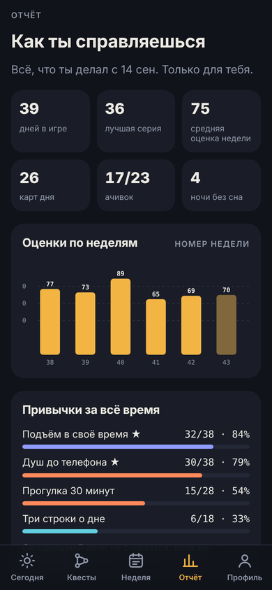
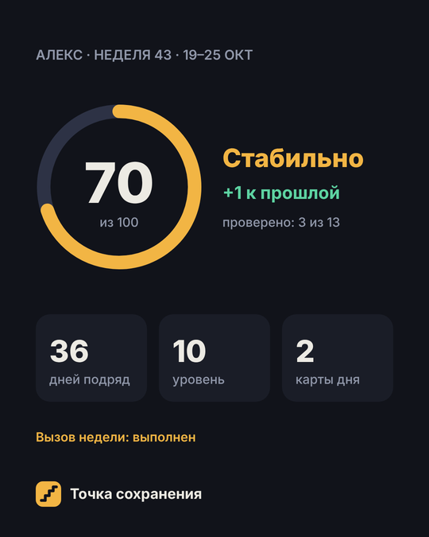

<div align="center">


# Точка сохранения

**Трекер привычек в виде игры.** Ежедневные квесты, случайная карта дня, вызов недели, боссы с полоской здоровья и оценка недели из 100. Привычки, которые закрепились, уходят на автопилот, и приложение становится нужно всё меньше.


&nbsp;&nbsp;&nbsp;&nbsp;

</div>

---

## Установка

1. Открой ссылку на приложение в **Safari** на айфоне или в **Chrome** на андроиде.
2. Айфон: **«Поделиться» → «На экран "Домой"»**. Андроид: **меню ⋮ → «Добавить на главный экран»**.
3. Один раз запусти приложение с иконки при интернете. После этого оно работает **без сети**.

Регистрация не нужна, сервера нет, всё бесплатно.

## Первый запуск

Сначала короткий гайд с правилами, потом анкета из семи шагов:

1. **Имя**: так приложение будет к тебе обращаться.
2. **Режим**: время подъёма и отбоя. От них зависят окна отметок.
3. **Первые квесты**: до двух привычек на старт. Остальные откроются с уровнем.
4. **Боссы**: до трёх больших целей. Можно пропустить.
5. **Разовые дела**: то, что давно откладываешь. Есть готовый список, можно добавить своё.
6. **Награды**: на что тратить заработанные монеты.
7. **Стиль**: тон недельной сводки и тема оформления.

Анкету можно пройти заново в любой момент: **Профиль → Изменить анкету**.

<div align="center">
&nbsp;&nbsp;&nbsp;&nbsp;
</div>

## Что внутри

| | |
|---|---|
| 🗡 **Квесты дня** | Каталог из 27 привычек в пяти характеристиках: сон, тело, деньги, люди, голова. Сначала два слота, новые открываются с уровнем. |
| 🃏 **Карта дня** | Каждый день случайное задание из колоды на 80 карт. Три редкости, одно перетягивание в день. |
| 🏆 **Вызов недели** | Одно задание посложнее. Можно поставить монеты: выполнил — ставка ×2, нет — сгорает. |
| 🐉 **Боссы** | Большие цели с полоской здоровья, до трёх одновременно. У каждого типа своя механика (таблица ниже). |
| 📊 **Оценка недели из 100** | Квесты (60) + стабильность (20) + боссы (10) + рывок (10). Ранги: Разгон, В деле, Стабильно, Машина. |
| 📤 **Карточка для друзей** | Картинка с оценкой, рангом, серией и уровнем. Подробностей о целях и заметках на ней нет. |
| 🪙 **Магазин наград** | Монеты за квесты, карты, вызовы и боссов. Награды задаёшь сам. |
| 🏅 **Ачивки** | 23 штуки. Выдаются автоматически по данным, нажать их нельзя. |
| 📅 **Напоминания** | Кнопка у квеста добавляет ежедневное событие в Календарь телефона. |
| 📓 **Отчёт** | График недель, процент по каждой привычке, прогресс боссов, причины пропусков, журнал дней, выгрузка в таблицу. |
| ✈️ **Автопилот** | Привычка, которая держится 21 день из 28, уходит из ежедневного списка и освобождает слот. |

### Типы боссов

| Тип | Как наносить урон |
|---|---|
| **Долг** | Каждый платёж уменьшает здоровье босса |
| **Накопить** | Каждое пополнение копилки — урон |
| **Вес** | Записываешь вес; босс слабеет по мере приближения к цели (работает и на похудение, и на набор) |
| **Вредная привычка** | Отмечаешь чистые дни. Срыв лечит босса на несколько дней, но опыт не отнимает |
| **Экранное время** | Раз в неделю записываешь среднее из системной статистики |
| **Чтение** | Прочитанные страницы |
| **Учёба или проект** | Часы работы |
| **Дистанция** | Пройденные километры |
| **Общение** | Встречи с людьми вживую |
| **Свой босс** | Любая цель в своих единицах |

Побеждённые боссы попадают в трофеи и дают +500 опыта.

<div align="center">
&nbsp;&nbsp;&nbsp;&nbsp;
</div>

## Правила честной игры

Накликать прогресс неудобно и заметно:

- **Окна отметок.** У каждого квеста своё время: утренние только утром, вечерние только вечером. Задним числом нельзя.
- **Одно исправление в неделю**, если правда забыл нажать вчера. Засчитывается вполсилы и без монет.
- **Фото с камеры** для части квестов и карт. Без фото — половина опыта и ноль монет.
- **Таймеры** для квестов на время. «Финиш» не сработает раньше срока.
- **Детектор спринт-кликера.** Три отметки меньше чем за минуту — приложение спросит, всё ли честно. Две такие ситуации за неделю — неделя получает ⚠, ачивки замораживаются, а на карточке для друзей это видно вместе со строкой «проверено X из Y».

Чтобы срыв не убивал мотивацию:

- **Два щита в неделю** закрывают пропущенный день без штрафа.
- **Серия не обнуляется**: без щитов она падает наполовину.
- **«Не ложился спать»** — запись бессонной ночи и причины без наказания, чтобы видеть закономерности в отчёте.
- **День заканчивается в 04:00**, так что поздний отбой засчитывается во вчерашний день.

## Приватность

- Все записи хранятся **только на устройстве** (localStorage и IndexedDB браузера).
- В этом репозитории лежит **только код**. Открыв ссылку, любой человек получит **пустое** приложение для своих данных.
- Приложение ничего никуда не отправляет: нет сервера, аналитики и аккаунтов.
- Фото-подтверждения хранятся 2 недели и удаляются автоматически.

> **Важно:** удалишь иконку или очистишь данные браузера — прогресс пропадёт. Приложение раз в неделю напоминает сохранить резервную копию: **Профиль → Сохранить копию**.

## Обновления

Приложение обновляется само. При следующем запуске с интернетом оно подтягивает новую версию, перезагружается и показывает окно **«Что нового»** со списком изменений. Прогресс и настройки сохраняются.

## FAQ

<details>
<summary><b>Почему нет push-уведомлений?</b></summary>

Пуши требуют сервера, а приложение работает без него. Напоминания ставятся через Календарь: вкладка «Квесты» → время у квеста → «В Календарь».
</details>

<details>
<summary><b>Как перенести прогресс на другой телефон?</b></summary>

На старом: Профиль → Сохранить копию. На новом: установи приложение → «Восстановить из резервной копии» на первом шаге анкеты или в Профиле. Фото не переносятся.
</details>

<details>
<summary><b>Можно поменять квесты, карты, боссов под себя?</b></summary>

Да. Свои разовые дела, награды и боссов можно добавить прямо в приложении. Весь встроенный контент лежит в одном файле [`data.js`](data.js).
</details>

## Для разработчика

Чистые HTML, CSS и JavaScript без сборки и зависимостей. Хостинг — GitHub Pages.

```
index.html            точка входа
app.js                логика и экраны
data.js               контент: квесты, колода, вызовы, боссы, ачивки, версия и список изменений
app.css               стили, светлая и тёмная тема
sw.js                 офлайн-кэш (service worker)
manifest.webmanifest  установка на главный экран
docs/screens/         скриншоты для README
```

**Выпуск новой версии:**
1. Подними `APP_VERSION` в `data.js` и добавь запись в начало `CHANGELOG`.
2. Подними `VERSION` в `sw.js`, иначе устройства продолжат брать старые файлы из кэша.
3. Закоммить в `main`. GitHub Pages обновится за 1–2 минуты.

Локальный запуск: `python3 -m http.server` в папке проекта и `http://localhost:8000` в браузере.

---

<div align="center"><sub>Приложение помогает с привычками, но не заменяет врача и психолога.</sub></div>
