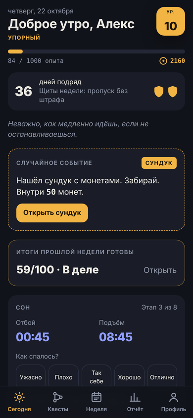
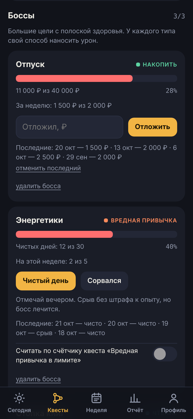
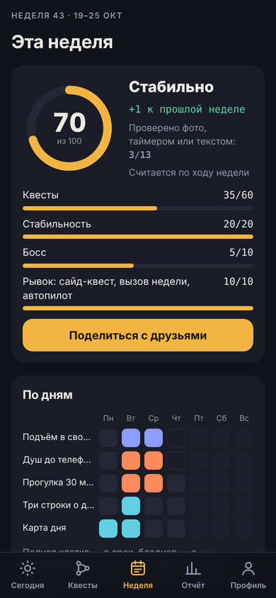
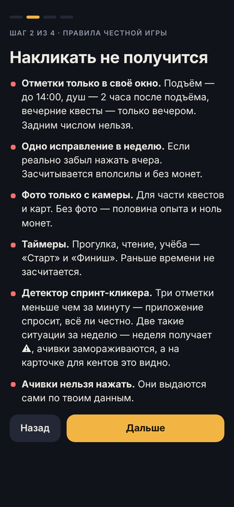
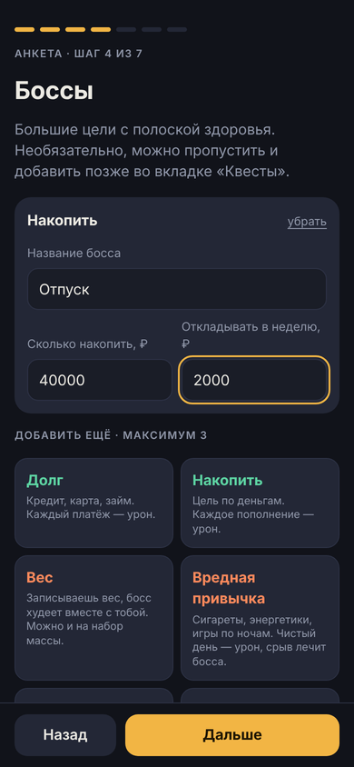
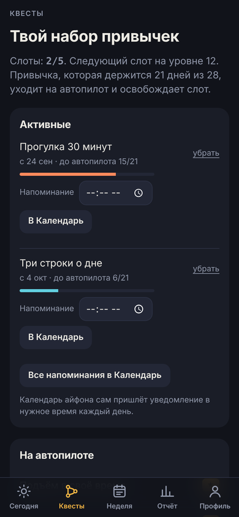
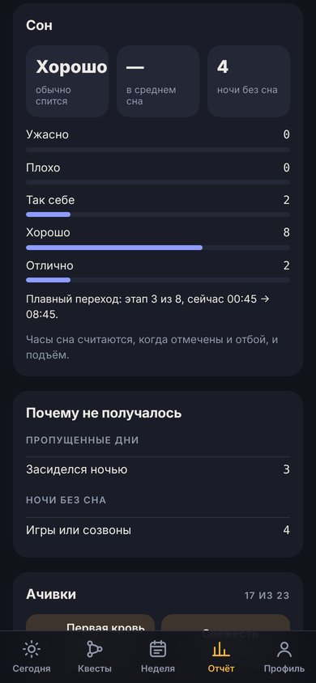
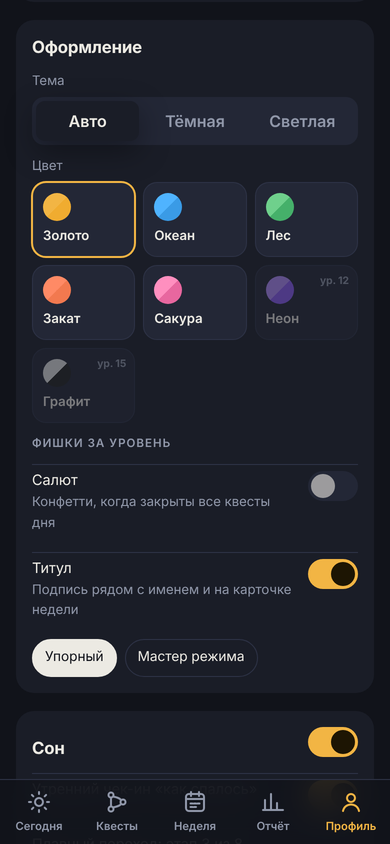
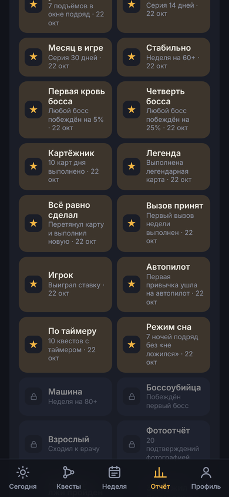

<div align="center">


# Точка сохранения

**Трекер привычек в виде игры.** Ежедневные квесты, случайная карта дня, вызов недели, боссы с полоской здоровья, режим сна и оценка недели из 100. Привычки, которые закрепились, уходят на автопилот.


&nbsp;&nbsp;&nbsp;&nbsp;

</div>

---

## Установка

1. Открой ссылку на приложение в **Safari** на айфоне или в **Chrome** на андроиде.
2. Айфон: **«Поделиться» → «На экран "Домой"»**. Андроид: **меню ⋮ → «Добавить на главный экран»**.
3. Запусти приложение с иконки один раз при интернете. Дальше оно работает **без сети**.

Регистрации и сервера нет, всё бесплатно.

## Первый запуск

Короткий гайд с правилами, затем анкета из семи шагов. Ничего не выбрано заранее, всё решаешь сам:

1. **Имя.**
2. **Режим**: во сколько хочешь ложиться и вставать, нужен ли режим сна.
3. **Первые квесты**: сколько хочешь, с рекомендацией по нагрузке.
4. **Боссы**: до трёх больших целей, можно пропустить.
5. **Разовые дела**: из готового списка или свои.
6. **Награды**: на что тратить монеты.
7. **Стиль**: тон недельной сводки, светлая или тёмная тема, цвет.

Анкету можно пройти заново: **Профиль → ⚙ Настройки → Изменить анкету**.

<div align="center">
&nbsp;&nbsp;&nbsp;&nbsp;
</div>

## Что внутри

| | |
|---|---|
| 🗡 **Квесты дня** | Каталог из 27 привычек в пяти характеристиках: сон, тело, деньги, люди, голова. Жёсткого лимита нет: приложение показывает нагрузку и рекомендацию (3 на старте, до 7 с уровнем). Связанные квесты, например подъём и отбой, считаются за один. |
| 🃏 **Карта дня** | Случайное задание из колоды на 80 карт. Три редкости, одно перетягивание в день. |
| 🏆 **Вызов недели** | Одно задание посложнее. На него можно поставить монеты: выполнил — ×2, нет — сгорают. |
| 🐉 **Боссы** | Большие цели с полоской здоровья, до трёх одновременно. У каждого типа своя механика. |
| 🌙 **Режим сна** | По желанию: плавный переход на новое время, время будильника на каждый день, утренний чек-ин «как спалось». |
| 📊 **Оценка недели из 100** | Квесты (60) + стабильность (20) + боссы (10) + рывок (10). Ранги: Разгон, В деле, Стабильно, Машина. |
| 📤 **Карточка для друзей** | Картинка с оценкой, рангом, серией и уровнем. Без подробностей о целях и заметках. |
| 🪙 **Магазин наград** | Монеты за квесты, карты, вызовы и боссов. Награды задаёшь сам. |
| 🎲 **Случайные события** | Иногда при первом заходе за день: сундук с монетами, двойной опыт, счастливая карта. На главном экране — фраза дня. |
| 🎨 **Темы** | Семь цветов, каждый в светлой и тёмной версии. Часть открывается с уровнем, как и фишки «Салют» и «Титул». |
| 🏅 **Ачивки** | 23 штуки. Выдаются автоматически по данным. |
| 📓 **Отчёт** | Подстраивается под то, чем пользуешься: привычки, боссы, сон, карты дня, причины срывов, журнал дней, выгрузка в таблицу. |
| ✈️ **Автопилот** | Привычка, которая держится 21 день из 28, уходит из ежедневного списка и освобождает слот. |

### Типы боссов

| Тип | Как наносить урон |
|---|---|
| **Долг** | Каждый платёж |
| **Накопить** | Каждое пополнение |
| **Вес** | Записываешь вес; босс слабеет по мере приближения к цели (похудение или набор) |
| **Вредная привычка** | Чистые дни. Срыв лечит босса на несколько дней, опыт не отнимает |
| **Экранное время** | Среднее за неделю из системной статистики |
| **Чтение** | Страницы |
| **Учёба или проект** | Часы |
| **Дистанция** | Километры |
| **Общение** | Встречи вживую |
| **Свой босс** | Любая цель в своих единицах |

### Режим сна

Включается в анкете или в настройках. Пока выключен, приложение ничего не показывает про сон.

- **Плавный переход.** Указываешь, во сколько ложишься и встаёшь сейчас, шаг (15 или 30 минут) и как часто сдвигать (раз в 2–4 дня). Цели квестов «Подъём» и «Отбой» подстраиваются под текущий этап.
- **Будильник.** В карточке сна написано, на сколько ставить будильник сегодня или завтра; в настройках — план «отбой → будильник» по датам.
- **Утренний чек-ин** и подсчёт часов сна по отметкам отбоя и подъёма.
- **«Не ложился этой ночью»** — запись бессонной ночи и причины. Отбой и подъём за эту ночь не засчитываются; отдельного штрафа нет.

<div align="center">
&nbsp;&nbsp;&nbsp;&nbsp;
</div>

## Правила честной игры

- **Окна отметок.** У каждого квеста своё время, задним числом отметить нельзя.
- **Одно исправление в неделю** — вполсилы и без монет.
- **Фото с камеры** для части квестов и карт. Без фото — половина опыта и ноль монет.
- **Таймеры** для квестов на время: «Финиш» не сработает раньше срока.
- **Детектор спринт-кликера.** Три отметки меньше чем за минуту — вопрос, всё ли честно. Две такие ситуации за неделю — неделя получает ⚠, ачивки замораживаются, а на карточке для друзей это видно вместе со строкой «проверено X из Y».

Чтобы срыв не убивал мотивацию:

- **Два щита в неделю** закрывают пропущенный день без штрафа.
- **Серия не обнуляется**: без щитов она падает наполовину.
- **День заканчивается в 04:00**, так что поздний отбой засчитывается во вчерашний день.
- **Старт в любой момент.** Квест, взятый после того, как его окно на сегодня закрылось, начинает считаться с завтра. Первая неделя оценивается со дня старта, вызов недели и цели боссов уменьшаются под оставшиеся дни.

## Приватность

- Все записи хранятся **только на устройстве** (localStorage и IndexedDB браузера).
- В репозитории только код. По ссылке любой человек получает **пустое** приложение для своих данных.
- Нет сервера, аналитики и аккаунтов.
- Фото-подтверждения удаляются через 2 недели.

> Удалишь иконку или очистишь данные браузера — прогресс пропадёт. Резервная копия: **Профиль → ⚙ Настройки → Сохранить копию**.

## FAQ

<details>
<summary><b>Почему нет push-уведомлений?</b></summary>

Для пушей нужен сервер. Напоминания о квестах ставятся через Календарь телефона: время у квеста во вкладке «Квесты» → «В Календарь». Будильник на подъём ставится в «Часах», время подсказывает карточка сна.
</details>

<details>
<summary><b>Как перенести прогресс на другой телефон?</b></summary>

На старом: Настройки → Сохранить копию. На новом: установи приложение → «Восстановить из резервной копии» на первом шаге анкеты. Фото не переносятся.
</details>

<details>
<summary><b>Можно поменять контент под себя?</b></summary>

Свои разовые дела, награды и боссов можно добавить прямо в приложении. Встроенные квесты, карты, вызовы, ачивки, темы и фразы лежат в [`data.js`](data.js).
</details>

## Для разработчика

Чистые HTML, CSS и JavaScript без сборки и зависимостей. Хостинг — GitHub Pages.

```
index.html            точка входа
app.js                логика и экраны
data.js               контент: квесты, колода, вызовы, боссы, ачивки, темы, фразы, версия
app.css               стили, светлая и тёмная тема
sw.js                 офлайн-кэш (service worker)
manifest.webmanifest  установка на главный экран
docs/screens/         скриншоты для README
```

При выпуске версии поднимаются `APP_VERSION` и `CHANGELOG` в `data.js` и `VERSION` в `sw.js`.

Локальный запуск: `python3 -m http.server` в папке проекта, затем `http://localhost:8000`.

---

<div align="center"><sub>Приложение помогает с привычками, но не заменяет врача и психолога.</sub></div>
